# PROJECT RECOVERY AUDIT: SRI MAHAVISHNU COLOUR GRAPHICZ
**Digital Platform & Agency Website Audit**  
**Audit Date:** September 2026  
**Auditor:** Antigravity AI Senior Technical Architect  
**Project Workspace:** `f:\GD Yoges\Corel\Colour-Graphicz Digital`  

---

## 1. Executive Summary

This Project Recovery Audit represents a comprehensive, code-level analysis of the **Sri Mahavishnu Colour Graphicz** codebase. 

The project is currently a **high-fidelity static frontend showcase / interactive marketing website** for a creative Design-to-Print & Packaging agency based in Sivakasi, Tamil Nadu, India. The homepage (`index.html`) has received substantial development and features complex visual components (3D card deck, mouse-follow image previews, sticky scroll stacks, interactive canvas dot-grid physics, and horizontal scroll pinned process stages). 

However, the secondary pages are in early prototype stages, data is hardcoded across pages, there is significant CSS/JS duplication between inline blocks and external asset files, and there is **no active backend, database, authentication, or automated workflow engine** in the repository.

| Metric | Status / Assessment |
| :--- | :--- |
| **Current Project Stage** | **Frontend Prototype / Design System Maturation** |
| **Frontend Architecture** | Static HTML5 + CSS3 + Bootstrap 5.3.3 + Vanilla ES6 JavaScript |
| **Backend / API Layer** | 🔴 **Not Implemented** (Frontend mock alerts only) |
| **Database / Persistence** | 🔴 **Not Implemented** (No migrations, tables, or storage) |
| **Workflow Automation** | 🔴 **Not Implemented** (Client-to-Print pipeline is manual/mocked) |
| **Production Readiness** | **Development / Interactive Prototype** |

---

## 2. Current Architecture

```mermaid
graph TD
    subgraph Client_Browser ["Client Browser (Frontend)"]
        Index["index.html (Homepage - 3,391 lines)"]
        About["pages/about.html"]
        Services["pages/services.html"]
        Portfolio["pages/portfolio.html"]
        Gallery["pages/gallery.html"]
        Contact["pages/contact.html"]
        Quote["pages/quotation.html"]
    end

    subgraph Design_System ["Styles & UI Assets"]
        CSS_Resp["css/responsive.css"]
        CSS_Pages["css/pages.css"]
        CSS_Hero["css/hero.css"]
        CSS_Nav["css/navbar.css"]
        CSS_Style["css/style.css"]
        Assets["assets/ (images, icons, video, logos)"]
    end

    subgraph Client_Scripts ["Scripts & Interactions"]
        Inline_JS["Embedded JS (Canvas, 3D Deck, Stack, IST Clock)"]
        JS_Nav["js/navbar.js"]
        JS_Theme["js/theme.js"]
        JS_Main["js/main.js"]
    end

    subgraph Backend_DB ["Backend & Persistence Layer"]
        Server["Server (None)"]
        DB[("Database (None)")]
        Storage["File Storage (Static Local Only)"]
    end

    Index --> Inline_JS
    Index --> CSS_Resp
    Index --> Assets
    About --> CSS_Pages
    About --> CSS_Resp
    Services --> CSS_Pages
    Portfolio --> CSS_Pages
    Gallery --> CSS_Pages
    Contact --> CSS_Pages
    Quote --> CSS_Pages

    Quote -.->|Mock alert| Server
    Contact -.->|Mock alert| Server
```



### 2.1 Technology Stack in Use
- **Markup**: HTML5 (Semantic headers, sections, mains, and footers).
- **CSS Framework**: Bootstrap 5.3.3 (via jsDelivr CDN) + Bootstrap Icons 1.11.3.
- **Custom Styling**: Vanilla CSS with CSS custom properties (`--ink`, `--paper`, `--accent`, `--coral`, `--subtext`, `--display`, `--sans`), radial gradients, backdrop filters, CSS Grid, and Flexbox.
- **Interactive Scripting**: Pure Vanilla ES6+ (Canvas 2D particle simulation, Pointer Drag events, Intersection/Scroll coordinate tracking, `Intl.DateTimeFormat` IST clock, `localStorage` theme state).
- **Fonts**: Google Fonts (`Space Grotesk` display + `Manrope` body).
- **Asset Structure**:
  - `assets/images/logo/colour-graphicz.png`
  - `assets/images/Clients LOGO/` (11 high-res brand logos)
  - `assets/images/services/` (`branding.png`, `packaging.png`)
  - `assets/images/hero cards/` (`UI- Card.png`)
  - `assets/images/hero/` (`portfolio-showreel.mp4`)
  - `assets/images/agency_main.png`, `assets/images/agency_desk.png`

---

## 3. Implemented Features & Audit by Module

### 3.1 Module Breakdown & Implementation Status

| Module / Component | Implementation Status | Functional Audit Details |
| :--- | :--- | :--- |
| **Global Theme System** | ✅ Complete | Light/Dark mode toggling with instant icon flip, `localStorage` persistence, and automatic CSS variable switching (`--paper`, `--ink`, `--line`). |
| **Live IST Flip Clock** | ✅ Complete | Real-time live India Standard Time (`Asia/Kolkata`) tabular digit flip animation in header utility tray and footer. |
| **Global Dot-Grid Canvas** | ✅ Complete | Full-window background particle grid with mouse proximity glow radius (180px) and click ripple shockwaves. |
| **Sticky Capsule Navbar** | ✅ Complete | Desktop floating capsule with active page indicator, smooth scroll background blur/elevation transition, and responsive mobile pill menu button. |
| **Homepage Hero 3D Deck** | ✅ Complete | 6 fanned cards with custom gradient backdrops, pointer drag event listeners, smooth 3-section sliding transitions, and 4s auto-advance loop. |
| **"Who We Are" Agency Section** | ✅ Complete | Editorial grid layout, continuous 360° rotating SVG text badge (`CREATE • IDEA • INSIGHT • SOLUTION`), story card, and 4-column metric counters. |
| **Client Logo Marquee** | ✅ Complete | Seamless infinite auto-scrolling marquee containing 11 brand logos with hover-pause and subtle scale transitions. |
| **Showcase Scroll-Stack** | ✅ Complete | Sticky overlapping cards (Velocity, Aura Botanicals, Spectrum Editorial, Prism Cartons) with custom follower "View" eye cursor. |
| **Interactive Services List** | ✅ Complete | 10 service rows with hover offset and cursor-following thumbnail preview floating box. |
| **7-Stage Process ("How We Work")** | ✅ Complete | 350vh pinned scroll track, animated gradient line fill, dynamic popping center stage indicator badge, and responsive card sizing. |
| **Floating CTA & Footer** | ✅ Complete | Pre-footer conversion card with direct tel links and quotation route, plus full 4-column footer with real Sivakasi contact details. |
| **About Page (`about.html`)** | 🟡 Partially Complete | Functional banner and 3 basic cards (Story, Mission, Tech), but lacks the visual richness, team showcase, and dynamic stats of the homepage. |
| **Services Page (`services.html`)** | 🟡 Partially Complete | 9 static service cards grid. Lacks interactive sub-service breakdowns, pricing estimators, or detailed modal popups. |
| **Portfolio Page (`portfolio.html`)** | 🟡 Partially Complete | 4 static portfolio cards. Lacks dynamic JSON data fetching (`portfolio.json`), category filter tabs, pagination, and modal case study detail view. |
| **Gallery Page (`gallery.html`)** | 🟡 Partially Complete | 4 static image items. Lacks dynamic masonry layout, media category filters, and interactive Lightbox modal with next/prev controls. |
| **Contact Page (`contact.html`)** | ⚠️ Broken / Placeholders | Contains raw unpopulated placeholders (`[BUSINESS ADDRESS]`, `[PHONE NUMBER]`, `[EMAIL ADDRESS]`) and dummy form submission alert. |
| **Quotation Page (`quotation.html`)** | 🟡 Partially Complete | Comprehensive frontend form fields (materials, quantities, finishing, dimensions) but form submission only triggers browser alert; no backend integration. |
| **Backend API & Routing** | 🔴 Not Implemented | No server runtime, REST endpoints, or serverless functions present in repository. |
| **Database & Migrations** | 🔴 Not Implemented | No database schema, ORM, or database connection configured. |
| **Workflow Management** | 🔴 Not Implemented | No automated tracking from Client enquiry → Job → Designer → Approval → Payment. |

---

## 4. Database Audit

| Audit Area | Findings |
| :--- | :--- |
| **Migrations** | None present. |
| **Tables / Schemas** | No tables exist. |
| **State Fields Needed** | Inquiries (`new`, `quoted`, `approved`, `in_production`, `dispatched`, `completed`), Quotes (`draft`, `sent`, `accepted`, `rejected`), Jobs (`assigned`, `designing`, `proofing`, `printing`, `finished`, `delivered`). |
| **Data Integrity Risks** | All user interactions currently fail to persist. Any quotation or contact form submissions are lost upon page reload. |
| **Sample Data** | Hardcoded sample data exists in HTML strings; no structured database seed files exist. |

---

## 5. API & Integration Audit

### Integration Chain Verification: `UI → Service → API → Database → Response → UI`

```text
[Quotation Form]  --> onsubmit="event.preventDefault(); alert(...)"  --> [STOPS AT BROWSER]
[Contact Form]    --> onsubmit="event.preventDefault(); alert(...)"  --> [STOPS AT BROWSER]
[Portfolio Grid]  --> Hardcoded static HTML (No fetch/JSON)          --> [STOPS AT DOM]
[Gallery Grid]    --> Hardcoded static HTML (No Lightbox/JSON)       --> [STOPS AT DOM]
```

- **Quotation Submission Path**: Disconnected. Data is not validated server-side, not saved to a database, and not dispatched via email/WhatsApp webhook.
- **Contact Message Path**: Disconnected.
- **Portfolio Data Loading**: Disconnected from `data/portfolio.json` mentioned in design specs.

---

## 6. UI/UX Audit

### 6.1 Strengths & Visual Highlights
- **Stunning Visual Polish**: The homepage delivers an extraordinary first impression with high-end typography (`Space Grotesk` + `Manrope`), neon lime accents (`#A0ED32`), vibrant coral (`#ff5426`), glassmorphism, and smooth cubic-bezier transitions.
- **Sophisticated Motion Design**: The 3D card deck, rotating SVG badge, pinned horizontal scroll stage, and dynamic canvas dot physics create an agency-grade feel.
- **Dark Mode Implementation**: Flawless dark-mode variable switching with tailored contrast ratios and backdrop filters.

### 6.2 UI/UX Gaps & Inconsistencies
1. **Placeholder Text Leakage**: `pages/contact.html` lines 87–99 render raw bracketed strings (`[BUSINESS ADDRESS]`, `[PHONE NUMBER]`, `[WHATSAPP NUMBER]`, `[EMAIL ADDRESS]`), while the site footer displays the verified Sivakasi address (`1073/3 P.K.N. Road, near Nandhini Bakery, Sivakasi - 626189`) and phone (`+91 84382 83441`).
2. **Design Disparity Between Homepage & Secondary Pages**: `index.html` has rich micro-interactions and depth, whereas secondary pages (`about.html`, `services.html`, `portfolio.html`, `gallery.html`) have minimal, plain card grids.
3. **Missing Lightbox in Gallery**: Clicking images in `gallery.html` does nothing.
4. **Missing Portfolio Filters & Modals**: `portfolio.html` lacks category filtering buttons (Packaging, Branding, Books, Labels) and modal popups.
5. **No File Upload UI in Quotation Form**: The quote form allows text input for specs but lacks an artwork upload drag-and-drop zone (PDF, AI, CDR, ZIP).

---

## 7. Business Workflow Audit

### Client → Project → Job → Designer → Design → Approval → Payment → Completion

```text
Target Workflow:
1. Client Enters Website & Submits Custom Specs / Artwork
2. System Generates Estimated Quote / Admin Reviews Specs
3. Client Approves Quote & Job Created
4. Job Assigned to Internal Graphic Designer
5. Designer Uploads Digital Proof / 3D Mockup
6. Client Receives Notification, Reviews Proof & Approves
7. Payment / Advance Processed (Razorpay / UPI / Gateway)
8. Offset/Digital Print Production -> Finishing -> Quality Check -> Dispatch Tracking
9. Order Delivered & Completed

Current Status in Repository:
- Steps 1-2: Frontend UI only (no data transmitted).
- Steps 3-9: Completely unbuilt (No backend / job management / portal).
```

---

## 8. Code Quality, Redundancy & Technical Debt

### 8.1 Critical Redundancies
1. **CSS Monolith in `index.html` vs External CSS**:
   - `index.html` contains **2,120 lines** of internal `<style>` sheet.
   - `css/pages.css` (1,277 lines), `css/hero.css` (88 lines), `css/navbar.css` (192 lines), and `css/responsive.css` (509 lines) contain duplicated and overlapping CSS rules.
2. **Script Duplication Across Pages**:
   - The global interactive dot-grid canvas script, IST clock script, and theme toggle logic are copy-pasted in full inside `index.html`, `about.html`, `services.html`, `portfolio.html`, `gallery.html`, `contact.html`, and `quotation.html` rather than being imported from shared files (`js/theme.js`, `js/navbar.js`, `js/canvas.js`).
3. **Dead / Unused Files**:
   - `js/main.js` is only 4 lines (`document.documentElement.classList.add("js-ready");`).
   - `js/theme.js` is partially superseded by inline theme toggle functions.
   - `css/hero.css` contains legacy hero layouts not used by the current `index.html`.

---

## 9. Security & Validation Audit

- **Input Sanitization**: No backend validation or sanitization exists.
- **Form Spam Protection**: Forms lack CAPTCHA / honeypot / rate limiting.
- **External CDN Dependency**: Relies on `cdn.jsdelivr.net` for Bootstrap 5.3.3 and icons. Subresource Integrity (SRI) hashes are present on `index.html` but missing on some secondary pages.
- **Sensitive Data**: No leaked secrets, API keys, or database credentials detected in client scripts.

---

## 10. Complete Pending Task List

### Critical Blockers (Phase 1) - ✅ COMPLETED
- [x] **Fix Contact Page Placeholders**: Replaced `[BUSINESS ADDRESS]`, `[PHONE NUMBER]`, `[WHATSAPP NUMBER]`, and `[EMAIL ADDRESS]` in `pages/contact.html` with verified Sivakasi headquarters data, interactive telephone, WhatsApp, and email links.
- [x] **Consolidate Code & Eliminate Redundancy**: Successfully modularized JavaScript into `js/theme.js`, `js/clock.js`, `js/canvas.js`, `js/navbar.js`, and `js/home-interactions.js`. Created unified `css/main.css`. Decoupled over 2,700 lines of inline styles and scripts from `index.html` and 6 secondary pages.

### High Priority (Phase 2 - Secondary Pages Elevation)
- [ ] **Dynamic Portfolio System**: Implement `data/portfolio.json`, category filter buttons (All, Branding, Packaging, Books, Labels), animated transitions, and project detail modal popups.
- [ ] **Interactive Gallery Lightbox**: Build responsive masonry grid with filter tabs and full-screen lightbox modal with next/prev image controls.
- [ ] **Enhanced Quotation Form**: Add file upload drag-and-drop zone with client-side preview, validation, and dynamic quantity pricing feedback.
- [ ] **Elevate About & Services Pages**: Enhance secondary pages with consistent rich typography, feature highlights, and interactive cards.

### Medium Priority (Phase 3 - Backend & Integration)
- [ ] **Backend Service / Form Handlers**: Implement backend endpoint to handle quotation and contact form submissions with email/WhatsApp notifications.
- [ ] **Database Setup**: Design database schema for Inquiries, Quotations, Portfolio items, and Client orders.

### Low Priority / Polish (Phase 4)
- [ ] **SEO Optimization**: Complete Open Graph meta tags, structured JSON-LD schema for LocalBusiness and PrintingService.
- [ ] **Asset Optimization**: Optimize large PNG/MP4 assets for sub-second initial load times across mobile devices.

---

## 11. Recommended Development Order

```text
Step 1: Code Sanitization & Centralization (Eliminate 2,000+ lines of duplicate CSS/JS)
   ↓
Step 2: Correct Secondary Pages Data & Contact Placeholders
   ↓
Step 3: Build Interactive Portfolio with JSON Dataset & Modal Viewers
   ↓
Step 4: Build Interactive Lightbox Gallery with Filtering
   ↓
Step 5: Build Artwork Upload & Validation on Quotation Form
   ↓
Step 6: Form Processing & Notification Integration (Email / WhatsApp API)
   ↓
Step 7: Full Cross-Device Responsive & Accessibility Verification
```

---

## 12. Production Readiness Assessment

- **Overall Readiness**: **DEVELOPMENT / PROTOTYPE**
- **Readiness Score**: **45 / 100**
- **Summary**: The homepage is an exceptional, visually stunning showcase that meets and exceeds design expectations. However, the project cannot be considered production-ready until secondary pages are brought to parity, duplicate CSS/JS is modularized, placeholder strings are resolved, and form interactions are connected to backend/notification services.
